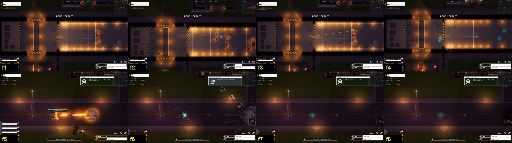

# First model face-off: Qwen vs Inkling 2 Mini on Mech Havoc (2026-11-23)

Two local vision models from Project Prometheus looked at the same 8 Mech Havoc frames.
Each answered twice per frame: once with **Drill's real prompt and JSON schema** (the call live
mode would make), and once with a plain **coach question** ("what's happening, and the single
most useful thing to do in the next 10 seconds?"). Then Claude read the same frames at full size
as the reference. No API key, nothing left the PC.

## Verdict

| | Qwen 3.8 27B (Q5) | Inkling 2 Mini (Q4) | Inkling, thinking capped at 256 |
| --- | --- | --- | --- |
| Live call right (what Drill would say at its 0.6 confidence bar) | 4 / 8 | 6 / 8 | 6 / 8 |
| Top pick right or acceptable, ignoring confidence | 4 / 8 | 4 / 8 | 4 / 8 |
| Seconds per Drill frame | **3.3 to 4.7** | 10.5 to 19.7 | 8.1 to 9.0 |
| Seconds per coach answer | **1.1 to 1.5** | 9.2 to 17.3 | 5.6 to 6.3 |
| Reads HUD numbers right (HP, ammo, objectives) | poor | **good** | good |
| Invents enemies that aren't there | often | sometimes | sometimes |
| "situation" label wrong | 6 / 8 (menu or low health in a fight) | 8 / 8 ("low health" 7 times at full HP) | 7 / 8 |
| False events logged | 2 "mission complete" | 4 ("big hit taken", "objective done", "mission complete") | 3 |

**In short:** Inkling *sees* the HUD much better, and its advice reads like a real teammate's,
but it can't switch off thinking, so it is 3 to 10 times slower. Qwen is fast enough to be close
to live speed but misreads the screen a lot. Its 4/8 score mostly comes from saying "none".
Neither model is good enough to pick calls on its own. That supports the PR #2 design:
**HUD readers and protocols decide, a model only describes.**

Inkling's 6/8 needs a caveat. On the quiet frames its wrong top picks fell below Drill's 0.6
confidence bar, so Drill would have stayed silent, which happened to be right. The bar did the
work, not the model.

## Frame by frame

Reference = Claude's read. ✓ right, ~ acceptable, ✗ wrong. "(silent)" = below 0.6, Drill says nothing.

| Frame | What's really there | Best call | Qwen call | Inkling call |
| --- | --- | --- | --- | --- |
| f1 range | Practice targets at 50-60 m, full HP, all call-ins ready | none | none ✓, but labelled "mission complete" | hit the objective 0.5 (silent) ✓ |
| f2 range | HMG 26 and firing, a dozen targets bunched | call the mortar | none ~, labelled "menu screen" | focus the big one 0.55 (silent) ~ |
| f3 range | Same, with a Hephaestus aim overlay | none | none ✓, labelled "menu screen" | hit the objective 0.6 ✗ |
| f4 range | Friendly units (cyan glow) near the player | none | **back off 0.85 ✗**: friends read as enemies, full HP read as low | reload later 0.55 (silent) ✓ |
| f5 street | **HMG at 0**, nothing shooting, objectives east | reload now | none ✗ | **reload now 0.65 ✓** |
| f6 street 00:04 | Mission start, own turret deploying, no enemies | none / move to objective | back off 0.75 ✗: "HP 368 is getting low" | reload later 0.65 ✗ |
| f7 street 00:08 | Hasn't moved, nothing around | keep moving | **keep moving ✓** | hit the objective 0.6 ~ |
| f8 street 00:12 | Still hasn't moved, **red dots on the minimap east** | keep moving | none ✗, labelled "mission complete" | hit the objective 0.6 ~ |

### What each one advised (the coach answers)

| Frame | Qwen | Inkling | Claude |
| --- | --- | --- | --- |
| f2 | "Hold the doorway, use your Precision Mortar (key 1)" (it treats training dummies as a swarm) | "Use the HMG on the cluster rather than the last Gauss round, consider a call-in" | Mortar the cluster; reload HMG (26) after |
| f4 | "Taking fire from two enemies, get behind the wall, mortar them" ✗ | "Finish the targets on the right, then extract" ✗ (also shoots friends) | They're friendly. Nothing to do |
| f5 | "Get into the road and fire your Gauss to help your buddy" | "Ammo nearly empty, use a ready call-in, don't out-gun it with empty weapons" | HMG is empty and it's safe: reload now, then push east |
| f7 | "Enemy vehicle to your left, turn and fire" ✗ (nothing there) | "Stop holding the beam up, engage the contact" (good catch: the aim line points north) | You've stood still 4 s, move east to the objectives |
| f8 | "Drive forward to grab the green pickup" ✗ (it's your turret) | "Engage the green mech ahead" ✗ (it's your turret) | Enemies on the minimap east; stop idling, move up behind your turret, face east |

## What both got wrong

- **Gauss Rifle "1".** Both said the Gauss is "nearly empty" in every frame. It shows 1 in all 8
  frames, and so does the AC-20 Canister, so it is most likely a one-shot-per-reload weapon and
  1 is normal. Worth checking in a vanilla run, then saying so in the profile's screen guide.
- **Friendly vs enemy.** Neither model knows cyan glow means friendly. Qwen told the player to
  back off from its allies; Inkling told the player to shoot its own turret. Add it to the
  profile's screen guide.
- **Minimap.** Neither noticed the red dots appearing east in f8, the one real early warning.
  That is a job for the minimap HUD reader, which already counts red dots.
- **Standing still.** The real lesson in f6 to f8 is "stood still for 8 seconds at mission start".
  No single frame shows it. A protocol with `hold_s` on a "not moving" fact catches it; a model
  looking at one frame never will.
- **Labels and events.** "situation" and "event" were wrong most of the time (Inkling said "low
  health" at 360/360 HP 7 times). If these went into the post-match review they'd invent deaths,
  hits and mission ends. HP, objectives and extraction should come from HUD readers only.

## What this means for Major Drill

1. **Live Drill (seconds matter):** keep protocols + HUD readers in charge. If a model is added
   as the optional describer, Qwen is the only one near the 3-second budget, and only for short
   answers (1.1 to 1.5 s). The full Drill JSON at 3.3 to 4.7 s is over budget.
2. **Post-match review (Major):** Inkling fits. 10 to 20 s per frame is fine after a match, and its
   HUD reading and advice are clearly better. Capping its thinking at 256 tokens halves the time
   and the advice is about as good.
3. **Prompt fixes that cost nothing:** add "cyan glow = friendly", "Gauss and AC-20 show 1 when
   loaded", and "the big mech labelled BUDDY is your helper" (mod only) to the profile.

## Limits of this test

- **No real recording exists on the PC.** Steam screenshots, Videos and NVIDIA folders are empty.
  These 8 frames are the best available: 4 from Hephaestus's training-range test fixtures and 4
  from its in-mission proof shots (one 3-frame, 8-second sequence). All were taken **with the
  Hephaestus mods on** (the BUDDY mech, "Suppress here" markers, a fifth call-in, the aim
  overlay in f3). I did not play the game with automated input.
- 8 frames and one reference reader (Claude). It shows the pattern, not a precise score.
- `wtmate bench` itself needs a recorded match plus a reference review, so this run used a
  small runner, [`tools/prometheus_bench.py`](../../tools/prometheus_bench.py), with Drill's
  exact prompt and schema. Once there is a vanilla recording: `wtmate ingest` it, then
  `wtmate bench` with both models as `[[contenders]]`.

## How the models run (Project Prometheus)

Both are GGUF files with a vision projector, served by **llama.cpp's `llama-server`** (the
Unsloth build `b12588-mix`, CUDA 13) on the RTX 5090, one at a time. Settings follow Prometheus's
`tools/assistant_arena/run.py`: all layers on the GPU, flash attention, 16k context.

| | File | Vision | Thinking off? |
| --- | --- | --- | --- |
| Qwen | `models/qwen3.8-27b-huihui-q5/Huihui-Qwen3.8-27B-abliterated-Q5_K.gguf` (19.5 GB) | `mmproj-model-bf16.gguf` | yes, `enable_thinking=false` |
| Inkling 2 Mini | `models/inkling-2-mini-unsloth/Inkling-2-Mini-UD-Q4_K_XL.gguf` (17.6 GB) | `mmproj-F16.gguf` | no, `reasoning_effort=none` is its minimum and still thinks ~1,000 tokens |

Rerun: `python tools/prometheus_bench.py bench/prometheus-2026-11-23` (add
`inkling --think-budget 256 --tag=-capped` for the capped run). Raw answers are in `runs/`,
Claude's reference read in `reference.json`.
